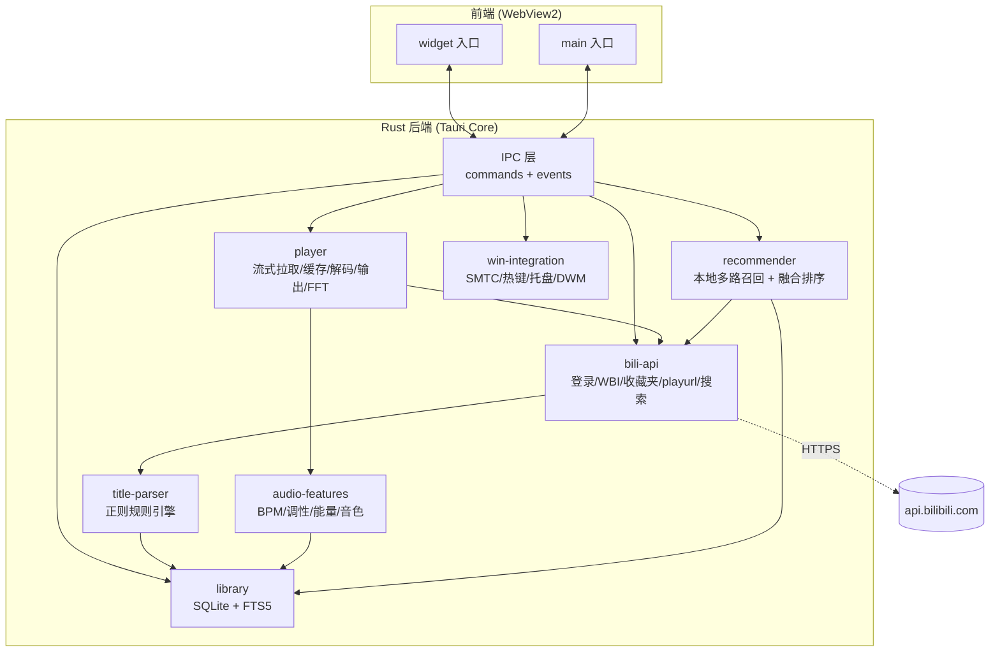
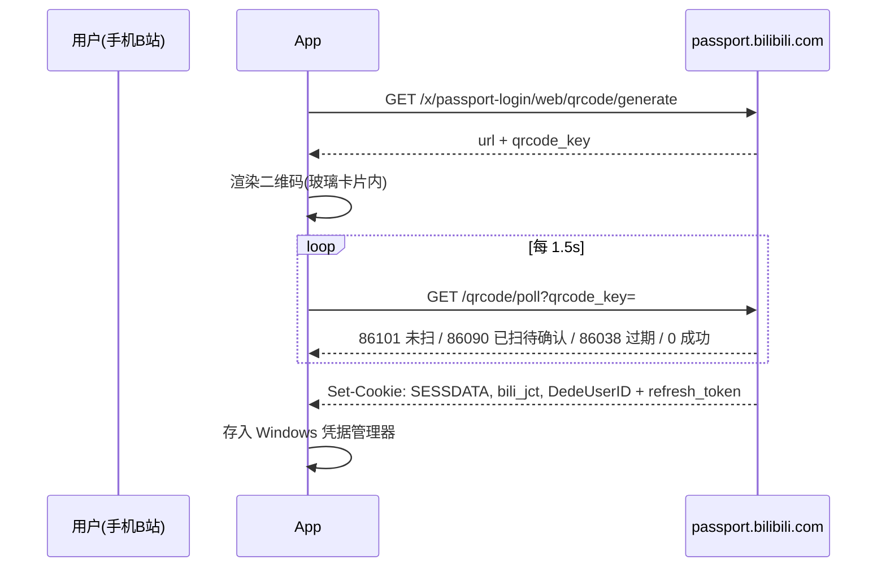
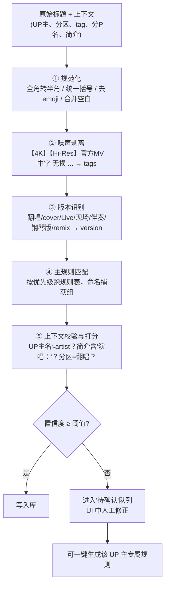
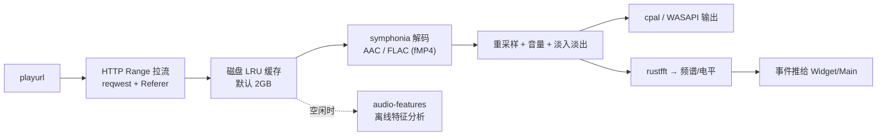
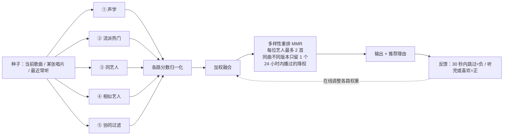
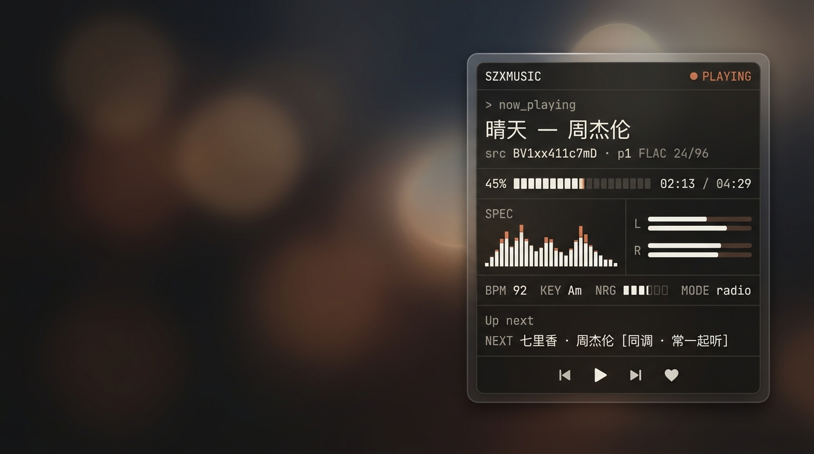
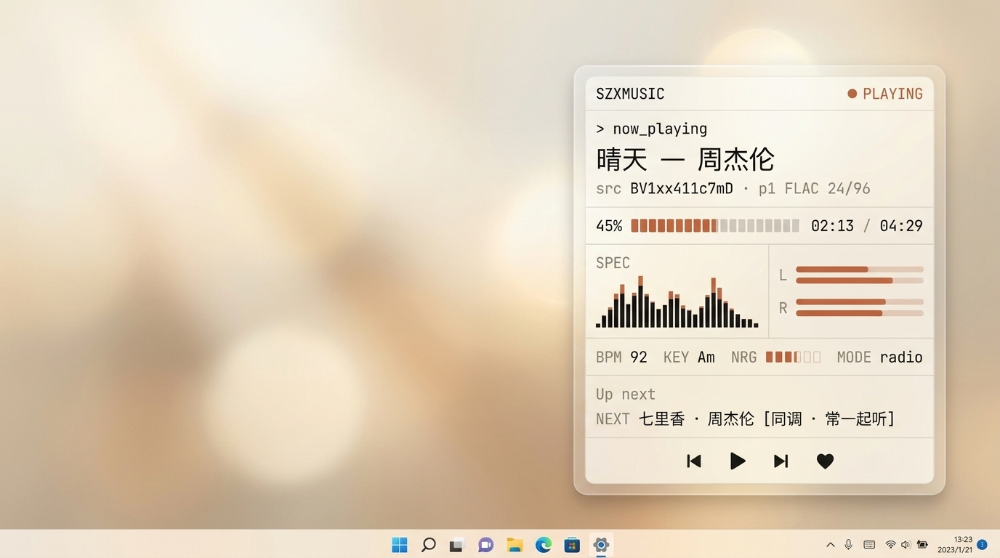
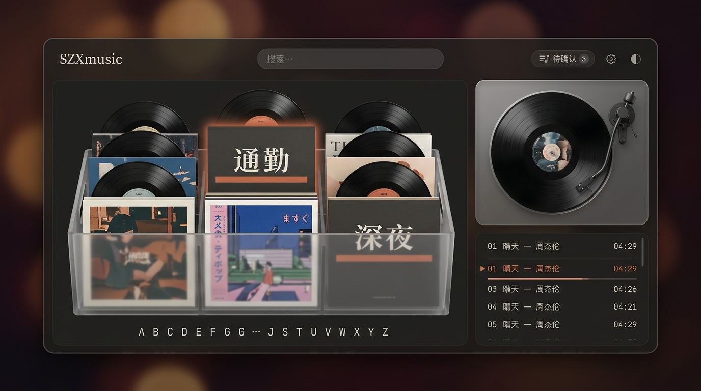
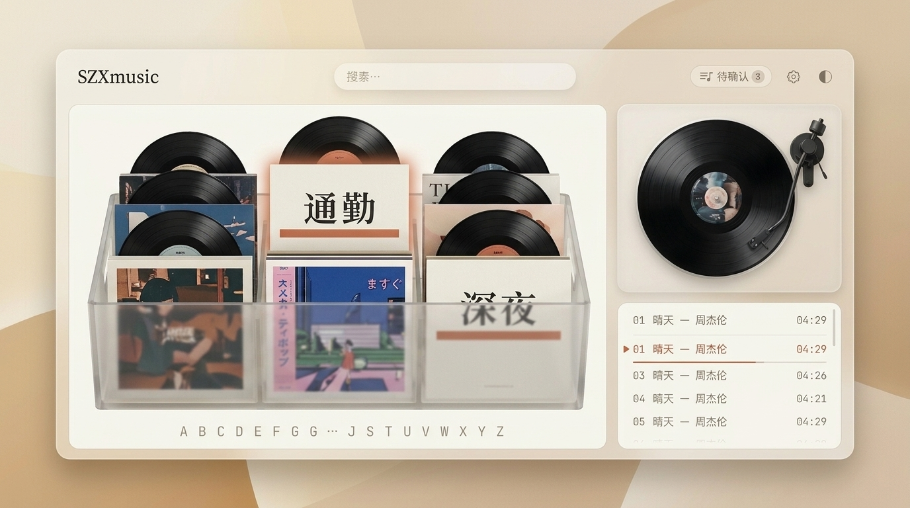

# SZXmusic 开发文档 v0.3

> 一个以 B 站为音源的 Windows 小型桌面音乐应用：
> **登录 B 站账号 → 导入收藏夹 / 合集 → 用正则识别视频标题，整理出"歌曲—艺人—版本"→ 建成本地音乐库**。
> 外观分两部分：**液态玻璃材质的终端风桌面挂件**（类似 CPU/GPU 监控小部件），和打开后**由一张张黑胶唱片错叠组成的主界面**。

状态：v0.3，主要决策已全部确认。概念图见第 14 节。

| 已确认 ✅ | 结论 |
|---|---|
| 应用名 | **SZXmusic** |
| 技术栈 | Tauri 2 + Rust + React/TS |
| 配色 | Claude 风格：黑底 + 橙（深色）/ 米白底 + 橙（浅色） |
| 主界面布局 | A：磨砂玻璃唱片箱，3 列 × 前后错叠，封套里露出半张黑胶；封套统一使用原视频封面 |
| 玻璃强度 | 中等：磨砂 + 高光边 |
| 推荐 | 首版就做。参考 Embeat 的多路召回思路，**在本地实现**，不依赖 Embeat 服务 |
| 挂件 | **置顶悬浮**；开机自启做成设置开关（默认关闭） |
| 同步 | **不向 B 站上报**播放记录；B 站收藏夹里**新增的内容自动同步**到软件 |

---

## 1. 参考项目：借鉴什么

| 项目 | 关键信息 | 我们借鉴的 | 不照搬的 |
|---|---|---|---|
| [licpp/BiliMusic-Desktop](https://github.com/licpp/BiliMusic-Desktop)（MIT） | React + TS 界面，Rust + Tauri + SQLite 业务层；扫码登录、收藏夹/合集/分P、歌词、迷你播放器、媒体键 | 技术栈路线（Tauri 2 + Rust + SQLite）、B 站数据模型（视频 / 分P / 收藏夹）、迷你播放器和 SMTC 思路 | 多端（移动端 / 鸿蒙）和坚果云同步。本项目**只做 Windows**，体积和交互都往"挂件"方向收窄 |
| [gdstudio-org/Embeat](https://github.com/gdstudio-org/Embeat)（CC-BY-NC 4.0） | 用 4500 万 Spotify 曲目训练的 item-to-item 推荐；EmbeatMLP 声学向量 + Track2Vec 歌单共现；5 路召回；能用**歌名 + 艺人名**查种子曲；Qdrant 部署要 2GB+ 内存，响应 30–200 ms | **5 路召回 + 融合打分**的架构：声学相似 / 同流派热门 / 同艺人 / 相似艺人 / 歌单协同过滤，以及它对推荐**多样性**的重视 | 不用它的代码、权重和数据（CC-BY-NC）。每一路都换成本地能拿到的信号自己实现（见第 10 节） |

> [!NOTE]
> BiliMusic 仓库有 `CLEAN_ROOM.md`。我们只参考架构思路，不复制它的代码。要复用的话，按 MIT 保留版权声明。

---

## 2. 产品形态


三个窗口共用一个 Rust 后端进程（播放器、库、B 站会话都只有一份）：

| 窗口 | 形态 | 说明 |
|---|---|---|
| **Widget 挂件** | 无边框、透明、不进任务栏、可吸附屏幕边缘 | 常驻桌面。有 S / M / L 三档尺寸，可以锁定位置、开启鼠标穿透 |
| **Main 主界面** | 无边框、液态玻璃背景、约 1100×720，可缩放 | 黑胶错叠浏览 → 点开唱片 → 曲目列表 / 播放 |
| **托盘** | 原生菜单 | 播放控制、显示/隐藏挂件、退出 |

---

## 3. 技术选型 ✅

| 层 | 选型 | 理由 |
|---|---|---|
| 壳 | **Tauri 2**（Windows 上用 WebView2 / Chromium） | 安装包约 10 MB 量级，Rust 后端性能好，与 BiliMusic 同路线。Chromium 内核支持 SVG 位移滤镜，液态玻璃的"折射"效果靠它实现 |
| 前端 | React 18 + TypeScript + Vite + Zustand | 两个窗口用多入口构建（`widget.html` / `main.html`） |
| 动效 | Motion（Framer Motion）+ CSS 3D。黑胶高光用 Canvas/CSS 渐变，可选 react-three-fiber | 唱片错叠需要大量带弹簧手感的过渡动画 |
| 后端 | Rust：`reqwest`、`tokio`、`serde`、`rusqlite`（含 FTS5）、`regex` / `fancy-regex` | 正则引擎、B 站 API、库、播放器都放在 Rust 里 |
| 音频 | `symphonia`（解码 AAC / FLAC / fMP4）+ `cpal`（WASAPI 输出）+ `rustfft`（频谱） | 播放放在后端，挂件和主界面拿到的是同一份状态和频谱。网页里的 `<audio>` 跨窗口不好同步，也不方便加 B 站要求的 Referer |
| 系统集成 | `windows` crate：SMTC 媒体控制、全局热键、DWM 圆角；`window-vibrancy`：Acrylic / Mica | 需要媒体键和系统音量浮层联动 |
| 凭据 | `keyring`（Windows 凭据管理器）保存 Cookie / refresh_token | 不把凭据明文写进磁盘 |
| 推荐 | 自研：`rustfft` 提取声学特征 + 共现矩阵 / PPMI + 向量余弦相似。曲目量在 10 万以内时直接暴力 KNN，不需要向量数据库 | 本地运行，不用部署服务（见第 10 节） |

没选的方案：
- **Electron**：开发最快，但常驻内存 150 MB 以上，不适合挂件常驻。
- **WinUI 3 / C#**：Mica / Acrylic 最原生，但黑胶 3D 错叠和液态玻璃的定制成本高很多。

---

## 4. 总体架构



### 4.1 仓库结构

```
szxmusic/
├─ src-tauri/
│  ├─ src/main.rs              # 窗口、托盘、IPC 注册
│  └─ crates/
│     ├─ bili-api/             # 纯 API 客户端，可单测
│     ├─ title-parser/         # 正则引擎 + 规则 + 语料测试集
│     ├─ library/              # 数据库迁移、DAO、去重合并
│     ├─ player/               # 音频管线
│     ├─ audio-features/       # 声学特征提取
│     ├─ recommender/          # 多路召回 + 融合排序
│     └─ win-integration/
├─ src/
│  ├─ widget/                  # 挂件 UI
│  ├─ main/                    # 黑胶主界面
│  ├─ shared/glass/            # 液态玻璃组件（GlassPanel、Refraction 滤镜）
│  └─ shared/ipc/              # 自动生成的类型（tauri-specta）
├─ rules/default.toml          # 内置标题规则
└─ docs/
```

### 4.2 IPC 约定（节选）

| 类型 | 名称 | 方向 | 说明 |
|---|---|---|---|
| command | `auth_qr_start` / `auth_qr_poll` / `auth_logout` | FE→Core | 扫码登录 |
| command | `lib_import_favorites(media_ids)` | FE→Core | 导入收藏夹，进度通过事件推送 |
| command | `lib_list_crates()` / `lib_crate_tracks(id)` | FE→Core | 取唱片（歌单）和曲目 |
| command | `parser_test(title, ctx)` | FE→Core | 规则调试器 |
| command | `player_play(song_id)` / `pause` / `seek` / `next` | FE→Core | 播放控制 |
| event | `player://state` | Core→FE | 播放状态、进度、码率、缓冲，约 4 Hz |
| event | `player://spectrum` | Core→FE | 32/64 段频谱，30 fps。窗口不可见时停止推送 |
| event | `import://progress` | Core→FE | 导入和解析进度 |

---

## 5. B 站接入（bili-api）

> [!WARNING]
> 下面都是 B 站 Web 端的非公开接口，随时可能变动或触发风控。实现时要集中封装，加上限流、退避重试和错误码映射。

### 5.1 登录与会话



- **设备指纹**：首次启动调用 `/x/frontend/finger/spi` 获取 `buvid3/buvid4`，减少触发风控（-352 / 412）的概率。
- **WBI 签名**：从 `/x/web-interface/nav` 拿 `img_key/sub_key`，生成 mixin key 后给参数签名（`w_rid` + `wts`），每天刷新一次。
- **Cookie 刷新**：启动时调 `cookie/info` 检查是否需要刷新。需要的话按 refresh_token → correspond path（RSA-OAEP）→ refresh_csrf → `cookie/refresh` → `confirm/refresh` 的流程走完。
- **游客模式**：不登录也能搜索和播放，但只有低码率，也不能导入收藏夹。

### 5.2 用到的接口

| 用途 | 接口 | 备注 |
|---|---|---|
| 用户信息 | `/x/web-interface/nav` | 头像、昵称、大会员状态、WBI key |
| 我创建的收藏夹 | `/x/v3/fav/folder/created/list-all?up_mid=` | 每个收藏夹 → 一张"唱片" |
| 我收藏的合集 | `/x/v3/fav/folder/collected/list` | |
| 收藏夹内容 | `/x/v3/fav/resource/list?media_id=&pn=&ps=20`，`/x/v3/fav/resource/ids` | 先拿全部 ID 再分批取详情 |
| UP 主合集/系列 | `/x/polymer/web-space/seasons_archives_list` | |
| 视频详情 | `/x/web-interface/view?bvid=` | 标题、UP、分区、tag、分P(`pages[].cid/part`)、简介 |
| 音频流 | `/x/player/wbi/playurl?bvid=&cid=&fnval=4048&fourk=1` | 取 `dash.audio[]`，Hi-Res 取 `dash.flac`，杜比取 `dash.dolby` |
| 搜索 | `/x/web-interface/wbi/search/type?search_type=video` | 推荐结果找音源、手动换源 |
| 相关视频 | `/x/web-interface/archive/related?bvid=` | B 站自己的协同过滤信号，作为推荐的"大众喜好"那一路（第 10 节） |
| 视频标签 | `/x/tag/archive/tags?bvid=` | 当作流派 / 风格标签 |
| 字幕/歌词 | `/x/player/wbi/v2` → subtitle | P2 |
| 历史上报 | `/x/v2/history/report` | ❌ 不做：播放记录只保存在本地，不同步到 B 站 |

**音质优先级**：`30251 Hi-Res FLAC`（需大会员）→ `30280 192K` → `30232 132K` → `30216 64K`。杜比 `30250` 是 E-AC3，symphonia 不支持，首版跳过。

**拉流**：请求头必须带 `Referer: https://www.bilibili.com` 和桌面 UA。URL 带 `deadline`（约 2 小时过期），过期后重新调 playurl 并从原位置续播。

---

## 6. 标题识别引擎（title-parser）

这是项目的核心：把"【4K修复】周杰伦 - 晴天 官方MV 无损音质"这样的标题变成结构化数据。

### 6.1 输出结构

```rust
pub struct ParsedTrack {
    pub title: String,              // 晴天
    pub artists: Vec<String>,       // ["周杰伦"]
    pub version: Version,           // Original | Cover{by} | Live | Remix | Instrumental | Acoustic | Piano | Clip ...
    pub tags: Vec<String>,          // ["4K", "MV", "无损"]：剥离的修饰词保留成标签
    pub confidence: f32,            // 0..1
    pub rule_id: String,            // 命中的规则，便于调试
}
```

### 6.2 解析管线



### 6.3 规则格式（`rules/*.toml`，用户可编辑、可热加载）

```toml
[[rule]]
id = "bracket-artist"
priority = 90
pattern = '^【(?P<artist>[^】]{1,30})】\s*(?P<title>.+)$'
# 例：【周杰伦】晴天
tests = [ { in = "【周杰伦】晴天", title = "晴天", artist = "周杰伦" } ]

[[rule]]
id = "dash-separated"
priority = 80
pattern = '^(?P<artist>.+?)\s*[-–—]\s*(?P<title>.+)$'
# 例：周杰伦 - 晴天

[[rule]]
id = "book-title"
priority = 70
pattern = '《(?P<title>[^》]+)》'
artist_from = "uploader"          # 标题里没有艺人时，用 UP 主名兜底（降低置信度）

[[rule]]
id = "vocaloid-slash"
priority = 75
pattern = '^(?P<title>.+?)\s*/\s*(?P<artist>.+)$'
# 例：千本桜 / 初音ミク

[[rule]]
id = "cover"
kind = "version"
pattern = '(?i)(?:[\(（\[]?\s*(?:cover|翻唱|翻自)\s*[:：]?\s*(?P<orig>[^\)）\]]*)[\)）\]]?)'

[[uploader_rule]]                 # UP 主专属规则，优先级最高
mid = 123456
pattern = '^(?P<title>.+?)【(?P<artist>[^】]+)翻唱】'
```

### 6.4 要点

- **正则方言**：Rust `regex` 不支持前后断言和反向引用。规则里一旦用到这些，就自动改用 `fancy-regex`（会慢一些）。
- **测试语料**：`title-parser/corpus/*.jsonl` 准备 ≥500 条真实标题和期望输出，CI 跑准确率。目标是首版 Top-1 准确率 ≥85%。
- **分P / 合集拆曲**：
  - 多 P 视频的每个 `part` 当作一首单独解析；
  - 长合集视频用正则从简介或置顶评论里抽时间轴（`^(\d{1,2}:)?\d{1,2}:\d{2}\s+(.+)$`），切成带 `start_ms/end_ms` 的虚拟曲目。
- **规则调试器**：主界面的一个页面。输入标题后高亮命中的规则和捕获组，显示打分明细。
- **去重合并**：`title_norm + artist_norm`（简繁统一、小写、去标点，可选拼音）相同的视为同一首歌，挂多个音源，自动选"官方/认证 UP + 最高音质"作为首选。

---

## 7. 音乐库（library）

### 7.1 数据模型

```mermaid
erDiagram
    VIDEO ||--o{ PAGE : has
    VIDEO }o--o{ TAG : tagged
    PAGE ||--o{ SOURCE : provides
    SONG ||--o{ SOURCE : "played via"
    SONG }o--o{ ARTIST : by
    SONG ||--o| AUDIO_FEATURE : analyzed
    SONG ||--o{ CO_OCCUR : relates
    CRATE ||--o{ CRATE_ITEM : contains
    SONG ||--o{ CRATE_ITEM : in
    SONG ||--o{ PLAY_HISTORY : logs
    PAGE ||--o| PARSE_RECORD : parsed

    VIDEO { text bvid PK; int aid; text title; int owner_mid; text owner_name; text cover_url; int tid; int view_count; int pubdate }
    PAGE { int cid PK; text bvid FK; int page_no; text part; int duration_ms }
    TAG { int id PK; text name }
    SONG { int id PK; text title; text title_norm; text version; text cover_local }
    ARTIST { int id PK; text name; text name_norm }
    SOURCE { int id PK; int song_id FK; int cid FK; int start_ms; int end_ms; int best_quality; bool preferred }
    PARSE_RECORD { int cid PK; text raw_title; text rule_id; real confidence; bool manual }
    AUDIO_FEATURE { int song_id PK; blob vec_f32; real bpm; text key_mode; real energy; int analyzed_at }
    CO_OCCUR { int song_a; int song_b; text source; real weight }
    CRATE { int id PK; text kind; text name; text cover; int remote_media_id; int sort }
    CRATE_ITEM { int crate_id FK; int song_id FK; int pos }
    PLAY_HISTORY { int id PK; int song_id FK; int ts; int listened_ms; bool skipped }
```

- **CRATE（唱片）**：主界面上的每一张黑胶。`kind` 包括：
  - `favorite`：B 站收藏夹
  - `season`：合集
  - `artist`：按艺人自动生成
  - `smart`：智能规则（如"最近常听"、"翻唱"、"Live"）
  - `similar`：某首歌的相似推荐
  - `daily`：每日推荐
  - `custom`：自建
- **全文检索**：SQLite FTS5，可选拼音首字母列。
- **收藏夹自动同步（只拉取，不回写 B 站）✅**：
  - **什么时候同步**：启动时同步一次；之后每 15 分钟后台检查一次（可在设置里改成 5 / 15 / 30 / 60 分钟）；主界面也可以手动刷新。
  - **怎么做增量**：
    1. 先比较每个收藏夹的 `media_count` 和最近的收藏时间 `fav_time`，没变化的直接跳过；
    2. 有变化时，用 `/x/v3/fav/resource/ids` 拿到全部 ID，和本地做差集；
    3. 只对新增的视频取详情、跑标题解析，然后入库。
  - **B 站上新建的收藏夹**：自动生成一张新唱片，插进唱片箱。
  - **入库后的提示**：新歌在唱片上显示橙色"新"角标；挂件弹一行终端风提示 `+3 synced from 收藏夹「通勤」`；解析置信度低的进入待确认队列。
  - **B 站侧删除或失效的视频**：标灰，不删本地记录。
  - **限流**：同步任务走全局限流；遇到风控就暂停，下个周期再试。
- **封面**：B 站视频封面按 1:1 居中裁成唱片标签，本地缓存 WebP。

---

## 8. 播放器（player）



- 预加载下一首的前 10 秒，切歌无缝；可选 2–8 秒交叉淡入淡出。
- 虚拟曲目（合集切片）通过 `start_ms/end_ms` 自动 seek 和截止。
- 接入 SMTC：系统媒体浮层、键盘媒体键、锁屏信息。
- **技术验证（M0 必做）**：确认 symphonia 能处理 B 站 fMP4 里的 FLAC 和 AAC 分片。不行的话降级为 `ffmpeg-next` 或 libmpv 后端（接口不变）。

---

## 9. 视觉与交互设计

### 9.0 设计令牌：Claude 风格配色 ✅

整体气质是**温暖、克制、有纸感的极简**：用暖调的黑与米白（不用冷灰），橙色只做点缀（进度、频谱峰值、当前项、光标）。主题跟随系统深浅色，也可以手动切换。

| 令牌 | 深色（黑橙） | 浅色（白橙） | 用途 |
|---|---|---|---|
| `--bg` | `#1F1E1D` | `#FAF9F5` | 窗口底色（叠在玻璃下，约 55% 不透明） |
| `--panel` | `#262624` | `#F0EEE6` | 卡片 / 列表行 |
| `--line` | `#3D3A35` | `#E3E0D6` | 终端边框字符、分隔线 |
| `--ink` | `#F5F4EE` | `#141413` | 主文字 |
| `--ink-dim` | `#A8A69D` | `#6B6A64` | 次要信息：码率、BV 号、时间 |
| `--accent` | `#D97757` | `#C96442` | 进度条、频谱、选中项、光标（浅色主题用深一点的橙，保证对比度） |
| `--accent-soft` | `rgba(217,119,87,.18)` | `rgba(201,100,66,.12)` | 悬停底色、电平背景 |
| `--warn` | `#E0A458` | `#B7791F` | 低置信度、待确认 |

**字体**：
- 终端 / 数据：Sarasa Mono SC（更纱黑体，中英等宽对齐）
- 唱片封套标题 / 大标题：衬线体（思源宋体 / Noto Serif SC，西文配 Tiempos 风格衬线），呼应 Claude 的"衬线标题 + 等宽数据"搭配
- 正文 UI：系统无衬线（Segoe UI Variable + 微软雅黑）

> [!NOTE]
> 色值是按 Claude 的视觉风格取的近似值，用于自研界面，不使用 Anthropic / Claude 的 Logo 或商标。

### 9.1 液态玻璃怎么在 Windows 上实现（强度：中等 ✅）

> [!IMPORTANT]
> WebView 里的 CSS `backdrop-filter` **只能模糊窗口自己的内容，模糊不到窗口后面的桌面**。所以液态玻璃需要分层合成：

| 层 | 实现 | 中等强度下的参数 |
|---|---|---|
| L0 系统模糊 | `window-vibrancy::apply_acrylic`（Win10/11），Win11 可选 Mica | 磨砂透出桌面 |
| L1 着色层 | `--bg` 约 55% 不透明 + 2% 噪点纹理 | 保证终端文字对比度 ≥ 4.5:1 |
| L2 折射 | SVG `feDisplacementMap`，只作用在**窗口内的内容**上 | 力度小（scale ≈ 6–10），只在面板边缘约 12px 和悬停时出现，不做全面扭曲 |
| L3 高光边 | 顶部 1px 内高光（白 18%）+ 底部内阴影 + 很淡的 `conic-gradient` 描边，随鼠标偏移 | 深色主题里高光带一点暖橙 |
| L4 内容 | 终端文本 / 黑胶 | |

已知限制：
- Win10 上拖动 Acrylic 窗口会卡顿，拖动时临时降级为纯色；
- 圆角用 DWM `DWMWA_WINDOW_CORNER_PREFERENCE`（Win11），Win10 用 CSS 圆角加透明窗口。

### 9.2 挂件（Widget）：终端风格

参考对象：`btop` / `nvidia-smi` / Rainmeter 的系统监控皮肤。等宽字体，用块字符和盲文点阵画图。边框字符用 `--line`，数值用 `--ink`，进度和频谱峰值用 `--accent`。

```
╭─ SZXMUSIC ──────────────── ● PLAYING ─╮
│ > now_playing                           │
│   晴天 — 周杰伦                          │
│   src BV1xx411c7mD · p1   FLAC 24/96    │
│ ▕██████████████░░░░░░░░░▏ 02:13 / 04:29 │
│ SPEC ▁▂▄▆█▇▆▄▃▂▁▂▃▅▇█▆▄▂▁▁▂▃▄▅▃▂▁        │
│ L ▕████████████▏-6dB  R ▕███████████▏    │
│ BPM 92  KEY Am  NRG ▮▮▮▮▯  MODE radio   │
│ NEXT 七里香 · 周杰伦  [同调 · 常一起听]   │
│  ⏮   ⏯   ⏭   ♡   ⌂                      │
╰─────────────────────────────────────────╯
```

- **尺寸**：
  - S（单行：曲名 + 迷你频谱）
  - M（如上）
  - L（额外显示：频谱历史图——仿 CPU 占用曲线的盲文点阵；队列下 3 首；歌词滚动行）
- **特色**：BPM / 调性 / 能量直接来自推荐模块的声学特征（第 10 节）。下一首旁边显示推荐理由，和"监控面板"的数据感一致。
- **行为**：
  - 拖动、吸附边缘、锁定位置；
  - **置顶悬浮 ✅**：窗口始终在最前（`always_on_top`）。检测到前台是全屏程序（游戏、视频）时自动隐藏，退出全屏后恢复；托盘菜单和全局热键都能临时隐藏 / 显示；
  - **开机自启 ✅**：`tauri-plugin-autostart`，设置里开关，默认关闭；开机启动时只显示挂件，不打开主界面；
  - 可开鼠标穿透（按住 Alt 时恢复可交互）；
  - 打字机式的启动动画（像终端输出启动日志），橙色方块光标闪烁。
- **性能**：空闲时 CPU < 1%；窗口被遮挡或最小化时停止渲染频谱。

### 9.3 主界面：唱片架斜排（布局 A ✅）

```
 ┌──────────────────────────────────────────────────────────────┐
 │  ( 搜索…                       )      ☰ 待确认 3   ⚙   ◐     │  ← 玻璃胶囊顶栏
 │                                                              │
 │     ╱▔▔▔╲╱▔▔▔╲╱▔▔▔╲╱▔▔▔╲                    ╭──────────╮      │
 │    ▕ ◐  ▕ ◐  ▕ ◐  ▕ ◐   ╲    ← 封套顶部露出   │   唱机    │      │
 │    ▕████▕████▕████▕██████▏     半张黑胶      │  (  ◉  )  │      │
 │    ▕████▕████▕████▕██████▏                  │  ╲ 唱臂   │      │
 │    ▔▔▔▔▔▔▔▔▔▔▔▔▔▔▔▔▔▔▔▔▔▔  ← 磨砂玻璃唱片箱  ╰──────────╯      │
 │      A  B  C  …  (首字母索引)                                 │
 └──────────────────────────────────────────────────────────────┘
```

- **唱片箱**：从前上方约 15° 俯视。封套竖直插在箱子里、前后错叠，每张封套顶部露出约半张黑胶。最前面一张完全可见，后面的依次露出上边缘和黑胶。
- **封套**：
  - 所有唱片（收藏夹、合集、智能/推荐唱片）统一使用**原视频封面**（取首曲封面或 2×2 视频封面拼贴），在封套底角/脊柱处辅以简洁标签文字，不使用纯文字排版封套；
- **黑胶**：唱片标签是封面的圆形裁切；盘面用 `repeating-radial-gradient` 画纹槽，加一道 `conic-gradient` 高光，随鼠标转动角度。
- **交互**：
  1. 滚轮 / 拖动：像翻唱片箱一样，前面的封套向前倾倒，露出下一张（3D `rotateX` + 弹簧动画）；
  2. 悬停：黑胶从封套里向上抽出约 40%，开始缓慢旋转；
  3. 点击：黑胶完全抽出、飞到右侧唱机上，唱臂落下，以 33⅓ 转（1.8 秒一圈）旋转；左侧封套展开成终端风曲目列表，当前曲用橙色 `▶` 标出；
  4. 首字母索引快速跳转，顶部玻璃胶囊搜索。
- **其他页面**（同样是玻璃面板）：待确认队列、规则调试器、推荐解释面板、账号与同步、设置。
- **动效规范**：
  - 弹簧参数统一为 `stiffness 260 / damping 26`；
  - 只完整渲染当前位置前后各 12 张唱片，其余虚拟化；
  - 尊重系统的"减少动画"设置。

---

## 10. 推荐模块：本地多路召回（参考 Embeat）✅

### 10.1 和 Embeat 的对应关系

Embeat 有 5 路召回：声学相似 / 同流派热门 / 同艺人 / 相似艺人 / 歌单协同过滤，最后融合打分。它的两个模型依赖 Spotify 的声学特征和百万级歌单，这些数据我们拿不到。所以**每一路都换成本地或 B 站能拿到的信号**：

| # | Embeat 通道 | 本地实现 | 信号来源 |
|---|---|---|---|
| 1 | 声学相似（EmbeatMLP，64 维） | **自提取声学向量**（约 40 维），标准化后算余弦相似度 | 解码后的音频（见 10.2） |
| 2 | 同流派热门（6291 个细分流派） | B 站 **tag + 分区**作为流派，TF-IDF 向量；热度 = log(B 站播放量) × 本地播放次数 | `/x/tag/archive/tags`、`view` |
| 3 | 同艺人 | 标题解析出的 artist 关联 | library |
| 4 | 相似艺人 | 艺人在用户唱片里的共现 + B 站"相关视频"图按艺人聚合，算 PPMI | crates、related |
| 5 | 歌单协同过滤（Track2Vec） | ① **个人**：收藏夹 + 听歌会话（间隔 < 30 分钟的连续播放算一个"歌单"），做共现 PPMI；数据够多时（> 2000 首）训练轻量 item2vec<br/>② **大众**：B 站 `/archive/related` 相关视频，本身就是平台的协同过滤结果，过一遍 title-parser，只保留音乐 | sessions、related |

### 10.2 声学特征提取（audio-features）

- **什么时候算**：播放时顺带分析，或者空闲时后台低优先级分析缓存里的音频。没缓存的曲目只拉 64K 码率流，取开头、中段、结尾各 30 秒，省带宽。
- **特征**：

| 维度 | 特征 | 方法 | 相当于 Spotify 的 |
|---|---|---|---|
| 1 | BPM | onset 包络自相关 | tempo |
| 2–3 | 调性 + 大小调 | chroma（12 维）+ Krumhansl-Schmuckler 调性模板 | key / mode |
| 4–5 | 能量均值 / 方差 | RMS | energy、loudness |
| 6–8 | 频谱质心 / 滚降 / 平坦度 | STFT | 明亮度、acousticness 的近似 |
| 9 | onset 密度 + 节拍强度 | 谱通量 | danceability 的近似 |
| 10–35 | MFCC 13 维的均值和标准差 | mel 滤波 + DCT | 音色 |
| 36–40 | 动态范围、过零率、高低频能量比等 | — | instrumentalness 的粗略近似 |

- 整个曲库做 z-score 标准化，各维度组加权后再算余弦相似度。
- 曲库 10 万首以内直接暴力 KNN（40 维 × 10 万 < 10 ms），不需要向量库。
- **P2 进阶**：模仿 EmbeatMLP 的对比学习思路，把个人共现对当正样本，在本地训练一个小 MLP（40→32 维），让"听起来像"更贴近个人口味。

### 10.3 融合排序



- **默认权重**：声学 0.30 / 协同过滤 0.25 / 相似艺人 0.15 / 流派热门 0.15 / 同艺人 0.15。按用户反馈做简单的在线更新（带上下限）。
- **冷启动**：还没有声学特征时，把这一路的权重分给流派和大众协同过滤。
- **可解释**：每条推荐带终端风的理由标签，如 `[BPM≈92 · 同调 Am · 常一起听]`，挂件和列表里都会显示。

### 10.4 推荐的落地形态

| 形态 | 说明 |
|---|---|
| **相似唱片** | 任意歌曲右键 → 生成一张 `similar` 唱片，插进唱片箱 |
| **电台模式** | 队列播完后按当前歌曲无限续播（挂件里显示 `MODE radio`） |
| **每日唱片** | 每天 0 点根据最近 7 天的收听生成，排版封套上印日期 |
| **发现** | 大众协同过滤找到的、不在库里的 B 站音源，标"新"；喜欢后再入库 |

---

## 11. 合规、安全与风险

| 项 | 措施 |
|---|---|
| B 站内容版权 | 只做在线播放和个人缓存，不提供导出 / 下载分发。界面注明"与哔哩哔哩无隶属关系" |
| 接口风控 | 全局限流（如 ≤ 3 QPS）、指数退避、遇到 -352 暂停导入并提示；`related` / `tags` 这类推荐用的请求单独限流并缓存 7 天 |
| 账号安全 | Cookie 存 Windows 凭据管理器；日志自动脱敏 SESSDATA；支持一键登出并清除 |
| Embeat 许可 | 只借鉴架构思路（多路召回、融合、多样性），**不使用其代码、模型权重和数据集**，因此不受 CC-BY-NC 约束；在关于页致谢。以后如果要导入它的数据集，那部分功能只能非商用 |
| BiliMusic 许可 | MIT。只参考思路，不复制代码；复用的话保留版权声明 |
| 配色 | 只借用风格，不使用 Anthropic / Claude 的商标和 Logo |
| 接口变动 | `bili-api` 独立 crate，每个接口有契约测试，每天跑冒烟测试 |

---

## 12. 决策记录 ✅

| 问题 | 结论 |
|---|---|
| 挂件层级 | 置顶悬浮，全屏程序运行时自动隐藏 |
| 开机自启 | 做成开关，默认关闭 |
| 播放记录同步到 B 站 | 不同步 |
| 收藏夹同步 | B 站新增的收藏自动同步到软件（启动时 + 每 15 分钟） |
| 应用名 | SZXmusic |
| 唱片箱材质与排法 | 磨砂玻璃箱，3 列 × 前后错叠（封套统一用原视频封面） |

---

## 13. 里程碑

| 阶段 | 内容 | 交付物 | 预估 |
|---|---|---|---|
| **M0 视觉与技术验证** | 液态玻璃分层效果、挂件静态稿、唱片箱可交互原型；验证 symphonia 能否解码 B 站流 | 可运行的 demo + 截图 | 1–1.5 周 |
| **M1 账号与播放** | 扫码登录、WBI、Cookie 刷新；收藏夹导入；Rust 播放管线；SMTC | 能登录并播放收藏夹 | 2 周 |
| **M2 标题识别与音乐库** | 规则引擎、≥500 条语料、待确认队列、规则调试器、去重合并、FTS 搜索 | 结构化音乐库 | 2 周 |
| **M3 主界面完整版** | 唱片箱完整交互、唱机播放视图、排版封套生成、虚拟化 | 主界面可用 | 2 周 |
| **M4 挂件完整版** | 三档尺寸、频谱 / 电平 / 历史图、吸附 / 穿透 / 钉桌面、性能优化 | 挂件可日常使用 | 1 周 |
| **M5 本地推荐** | 声学特征提取、5 路召回、融合排序 + MMR、反馈学习、相似唱片 / 电台 / 每日唱片 / 发现 | 推荐可用 | 2–2.5 周 |
| **M6 打磨发布** | 分P / 时间轴拆曲、歌词、自动更新、安装包签名 | v1.0 | 1–1.5 周 |

---

## 14. 概念视觉稿

以下四张概念图按第 9 节令牌与布局生成，用于校准后续 M0/M3/M4 开发的视觉基准（真实界面将使用 React + SVG 滤镜 + Canvas/CSS 实时渲染，修正概念图中的静态文字错别字与重复项）。

### 14.1 桌面挂件（Widget · M 尺寸）

| 深色（黑橙 `#1F1E1D` + `#D97757`） | 浅色（米白橙 `#FAF9F5` + `#C96442`） |
|---|---|
|  |  |

**视觉验收要点**：
- **玻璃质感**：中等磨砂 Acrylic 模糊底噪 + 顶部 1px 亮边高光，文字在深浅壁纸下均保持高可读性。
- **监控终端风格**：等宽数据行（`src`、码率 `FLAC 24/96`、分段式进度条 `45%`、`SPEC` 频谱柱 + 橙色峰值、`L/R` 双声道电平、`BPM / KEY / NRG / MODE` 声学状态、`NEXT` 推荐理由标签），克制地只在高亮与峰值点缀暖橙。
- **实现修正项**：概念图底部播放按钮显示为 `▶`，实际运行时 `● PLAYING` 状态下应切换为暂停图标 `⏸`。

### 14.2 主界面（Main · 唱片架错叠 + 唱机）

| 深色（黑橙 `#1F1E1D` + `#D97757`） | 浅色（米白橙 `#FAF9F5` + `#C96442`） |
|---|---|
|  |  |

**视觉验收要点**：
- **顶栏**：左侧衬线字标 `SZXmusic`，中间玻璃胶囊搜索框，右侧 `待确认 3` 徽章、设置与主题切换。
- **磨砂玻璃唱片箱**：3 列 × 前后错叠的唱片阵（支持鼠标滚轮向后翻阅），悬停时唱片抽出一截并带微弱暖橙光晕。
- **右侧唱机与列表**：上方是黑胶旋转盘面与唱臂，下方是等宽终端风格曲目列表（当前曲目用橙色 `▶` 与细进度条标出）。
- **实现修正项**：真实界面中所有封套均改为**原视频封面**（替代概念图中的纯文字排版封套）；同时消除字母索引重复（`G G`）与曲目名重复。

